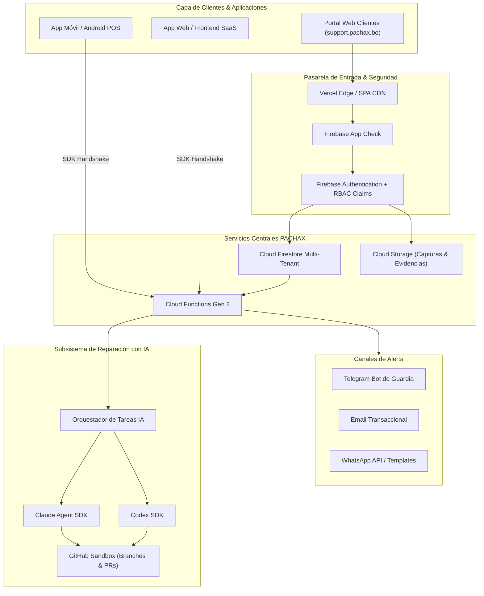

# Arquitectura Técnica — PACHAX Support Center

## 1. Visión General
**PACHAX Support Center** es una plataforma multi-tenant diseñada para gestionar incidencias, requerimientos de software, cotizaciones y ejecución de correcciones automatizadas mediante Inteligencia Artificial (Codex SDK / Claude Agent SDK).

El sistema desacopla completamente el portal de reporte del cliente de los repositorios de código fuente de los clientes finales (`pachax-platform`, `embutidos-sanjose`, `qb-insumos`), operando como una torre de control independiente con control de acceso estricto y auditoría.

---

## 2. Aislamiento Multi-Tenant

La base de datos y el almacenamiento se estructuran con aislamiento estricto por:
1. **Empresa Desarrolladora (`developerCompanies`)**: Identificador único (`dev-pachax-core`).
2. **Empresa Cliente (`clientCompanies`)**: Cada cliente posee su colección de usuarios, cuotas y proyectos.
3. **Proyectos (`projects`)**: Aplicaciones conectadas bajo cada cliente con sus propios tokens públicos de SDK.

### Jerarquía de Colecciones Firestore
- `/users/{userId}`: Perfil y rol de usuario (`superadmin`, `dev_owner`, `dev_admin`, `dev_engineer`, `dev_commercial`, `client_admin`, `client_user`).
- `/developerCompanies/{companyId}`: Configuración técnica, SLA, canales de alerta.
- `/clientCompanies/{clientId}`: Parámetros del cliente, límite diario de envíos, NIT, dominio.
- `/projects/{projectId}`: Proyectos, enlace a repositorio GitHub, tokens públicos de SDK.
- `/incidentReports/{reportId}`: Lote consolidado de incidencias (diarias o críticas).
- `/incidentItems/{itemId}`: Cada error individual con capturas, anotaciones, estado y elegibilidad de IA.
- `/featureRequests/{requestId}`: Solicitudes de mejoras y nuevas funciones.
- `/quotes/{quoteId}`: Presupuestos formales con desglose de tareas, horas y costos.
- `/aiRepairRuns/{runId}`: Ejecuciones del agente de IA, logs de terminal en vivo y estado de PR.
- `/auditLogs/{logId}`: Registro inmutable de acciones privilegiadas.

---

## 3. Política de Incidencias: General vs. Crítica

| Aspecto | Incidencias Generales | Incidencias Críticas (24/7) |
| :--- | :--- | :--- |
| **Frecuencia** | 1 lote consolidado por día por cliente | Sin límite de frecuencia temporal |
| **Estructura** | Soporta múltiples sub-errores con `+ Agregar error` | Enfocado en 1 bloqueo esencial inhabilitante |
| **SLA de Respuesta** | Menor a 12 horas hábiles | Menor a 60 minutos (24 horas / 7 días) |
| **Notificación** | Bandeja de triage y resumen diario | Alerta prioritaria inmediata a Telegram y correo |
| **Consentimiento** | Checkbox obligatorio reconociendo cuota diaria | Checkbox bajo responsabilidad de emergencia |

---

## 4. Editor de Anotaciones sobre Imágenes
El módulo `ImageAnnotationEditor` opera directamente sobre HTML5 Canvas con soporte para Pointer Events (mouse y gestos táctiles):
- Lápiz mano alzada con suavizado de curvas.
- Flechas direccionales con punta orientada vectorialmente.
- Rectángulos de enfoque.
- Círculos y óvalos de atención.
- Resaltador traslúcido con canal alfa.
- Cajas de texto explicativo con contraste de fondo.
- Pila inmutable de Deshacer / Rehacer.
- Exportación dual: Preserva la imagen original intacta y genera el PNG combinado con las anotaciones.
