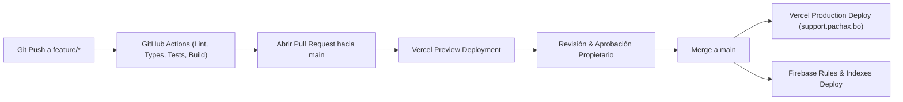

# Guía de Despliegue en Producción — PACHAX Support Center

## 1. Pipeline de Despliegue Automatizado



---

## 2. Despliegue del Frontend en Vercel

1. **Integración con Git:** El proyecto está conectado con el repositorio `pachaxbo-commits/pachax-support-center`.
2. **Build Automático:** Cada commit en la rama `main` compila `npm run build` y publica la versión en producción.
3. **Preview Deployments:** Cada rama `feature/*` o Pull Request genera automáticamente una URL de previsualización aislada para verificar visualmente los cambios antes del merge.

---

## 3. Despliegue del Backend en Firebase

Para publicar las reglas de seguridad, índices y Cloud Functions:

```bash
# 1. Asegurar cuenta correcta
firebase login:use pachax.bo@gmail.com

# 2. Desplegar reglas de Firestore e Índices
firebase deploy --only firestore --project pachax-support-center

# 3. Desplegar reglas de Cloud Storage
firebase deploy --only storage --project pachax-support-center

# 4. Desplegar Cloud Functions Gen 2
firebase deploy --only functions --project pachax-support-center
```

---

## 4. Verificación Post-Despliegue (Smoke Tests)
1. Carga inicial de `https://support.pachax.bo` (o la URL de preview de Vercel).
2. Apertura del selector de roles y navegación por las secciones de cliente y panel administrativo.
3. Creación de un error en el formulario de incidencias generales y verificación del editor de anotaciones sobre imágenes.
4. Consulta de estados en el historial.
