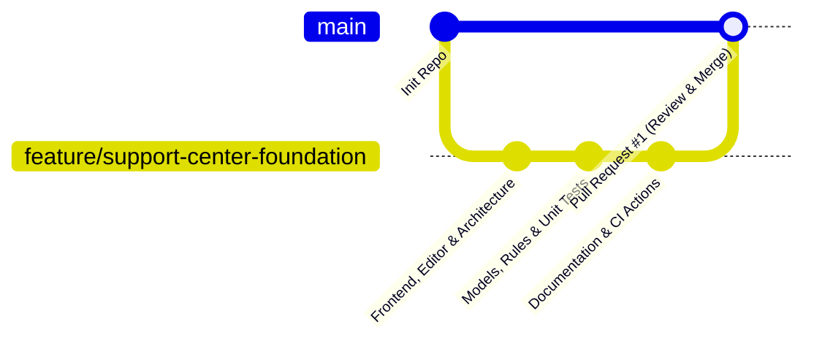

# Configuración de GitHub — PACHAX Support Center

## 1. Repositorio Oficial

- **Organización / Cuenta:** `pachaxbo-commits`
- **Nombre:** `pachax-support-center`
- **Visibilidad:** Privado
- **URL Web:** [https://github.com/pachaxbo-commits/pachax-support-center](https://github.com/pachaxbo-commits/pachax-support-center)
- **Protocolo de Operación:** Git / HTTPS con autenticación GitHub CLI (`gh`).

---

## 2. Estrategia de Ramas

1. **`main`**: Rama protegida para producción. Cada cambio pasa por Pull Request y verificación de build.
2. **`feature/support-center-foundation`**: Rama de desarrollo de la fase inicial donde se construye la base de la plataforma, componentes, reglas y pruebas.

---

## 3. Flujo de Integración Continua (GitHub Actions)

El repositorio incluye dos flujos de trabajo automatizados:

1. **`.github/workflows/ci.yml`**:
   - Se ejecuta en cada `push` y `pull_request`.
   - Pasos:
     1. `npm ci`
     2. `npm run typecheck` (verificación de tipos de TypeScript sin emitir código)
     3. `npm run test` (ejecución de suite Vitest con 100% de aserciones)
     4. `npm run build` (compilación del paquete de producción)

2. **`.github/workflows/preview-check.yml`**:
   - Verifica la integridad del build antes de permitir el despliegue automático de preview en Vercel.

---

## 4. Políticas de Seguridad de Código
- Está estrictamente prohibido commitear credenciales privadas, tokens de Firebase Admin (`serviceAccountKey.json`), claves de Telegram o tokens de GitHub.
- El archivo `.gitignore` excluye `.env`, `.env.local`, `dist`, `.vercel`, `coverage` y logs de debug.
