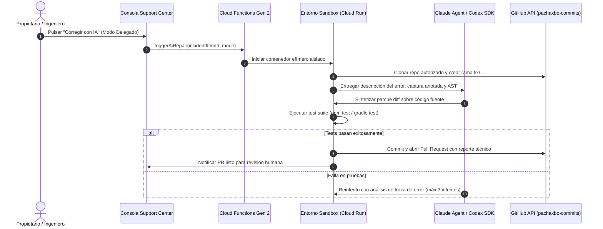

# Arquitectura de Integraciones — PACHAX Support Center

## 1. PACHAX Support SDK (Android, Web, SaaS)

El SDK de PACHAX Support permite a cualquier aplicación de la familia PACHAX o de clientes terceros incrustar un botón de soporte nativo:

### Características Clave
- **Sin credenciales permanentes:** La aplicación cliente únicamente almacena un `publicKey`.
- **Handshake temporal:** Solicita un token de sesión de corta duración firmado con HMAC.
- **Captura automática de contexto:** Sistema operativo, modelo de dispositivo, versión de app y trazas recientes de la consola.

---

## 2. Integración Especial con PACHAX Platform

Para instancias de **PACHAX Platform**, el payload de reporte incluye metadatos específicos de la arquitectura SaaS:

```typescript
export interface PachaxPlatformMetadata {
  tenantId: string;       // Identificador único de la empresa en la plataforma
  userId: string;         // ID del operador que reporta
  templateId: string;     // Plantilla utilizada (ej. 'retail-pos-v2', 'ecommerce-b2b')
  appVersion: string;     // Versión del bundle
  moduleAffected: string; // Módulo (ej. 'Facturación SIN', 'Inventario', 'Despachos')
  changeScope: 'client_specific' | 'template' | 'core';
}
```

- **`client_specific`**: Modificación requerida únicamente por ese cliente (califica para cotización a medida).
- **`template`**: Corrección sobre la plantilla estándar que beneficia a todas las empresas que usan esa plantilla.
- **`core`**: Falla estructural en el núcleo de PACHAX Platform.

---

## 3. Arquitectura del Agente de Reparación con IA (Codex & Claude)

El flujo de trabajo automatizado se estructura en 10 etapas controladas:



### Tres Modos de Operación
1. **Manual Supervisado:** El agente genera el diagnóstico y el diff; el ingeniero aprueba cada línea antes de commitear.
2. **Delegado con PR (Modo Estándar):** El agente diagnostica, repara, prueba y abre un Pull Request en GitHub. El merge lo realiza un humano.
3. **Autónomo Autorizado:** Reservado para fallas críticas con suites de pruebas verificadas al 100%. Mezcla a la rama principal y dispara el despliegue automático.

---

## 4. Canales de Notificación: Telegram y WhatsApp

- **Telegram:** Bot oficial despacha alertas en formato Markdown a grupos privados de soporte técnico para incidencias urgentes y aperturas de PRs de IA.
- **WhatsApp:** Generador dinámico de mensajes estructurados (`wa.me/?text=...`) y preparación para webhook con proveedor oficial (Twilio / Cloud API de Meta).
